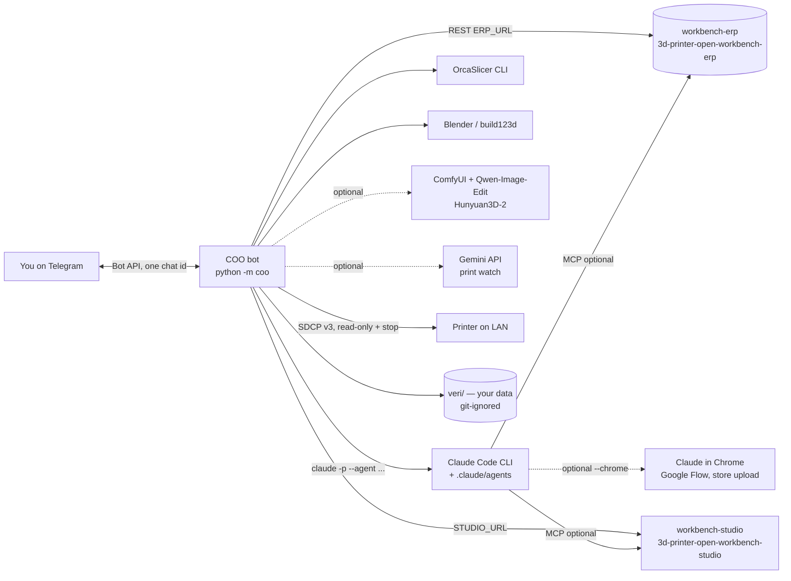

# 3D Printer Open Workbench — Bot

> 3D Printer Open Workbench: **Bot + agents** · [ERP](https://github.com/3d-printer-open-workbench/3d-printer-open-workbench-erp) · [Studio](https://github.com/3d-printer-open-workbench/3d-printer-open-workbench-studio)

[Türkçe](README.tr.md) · [Install guide](docs/install.md) · [Kurulum rehberi](docs/kurulum.md) · [Security](docs/security.md) · License: MIT

A Telegram-run assistant for a small 3D-printing business. You chat with one Telegram bot (the "COO"); behind it,
a team of [Claude Code](https://docs.claude.com/en/docs/claude-code) agents researches trends, turns an idea into a
printable product, slices it in OrcaSlicer, prepares store listings and social content, and keeps the books in an
optional ERP. Every step that spends money, publishes something or touches the printer waits for **your approval**.

> The bot's own UI and most agent prompts are in **Turkish** (it was built for a Turkish shop). Code identifiers are
> Turkish too. Translating the prompts in `.claude/agents/` and the bot strings is a welcome contribution.

## What it does

| Area | What happens | Who does it |
|---|---|---|
| Trends & ideas | Live market research (Etsy, marketplaces, Pinterest, Printables/MakerWorld) with source URLs and dates; pages read locally with Crawl4AI (`workbench-web` MCP); a visual catalog you pick from | `trend-researcher` (Sonnet) |
| Product pipeline | Concept → 3D model (CAD / Studio generators / optional AI 3D) → geometry quality gate → usage test → colors → slicing (3MF) | `cad-artist`, `mesh-validator`, `slicer-engineer` |
| Usage test | Does the product keep its promise? Real-size reference objects (headphones, game controllers, phones) are dropped onto / tilted / shaken on the model in a physics engine (MuJoCo + CoACD + python-fcl); clearances and tip-over angle are measured; optional silicone/rubber base pads (`urun.yaml > taban_pedi`) model stand–desk friction, and the touch test checks phone slip, stand tilt and stand slide. On FAIL a measured revision note goes to the CAD agent (max. 3 automatic rounds) | `kullanim-test-muhendisi`, `cad-artist` |
| Model changed → dependent outputs | When a usage test passes (or is approved) and the new STL is newer than the colors / slicing / ERP recipe / studio images / technical poster / store images, the bot lists the stale outputs (SHA-256 per output in `urun.yaml > model_surumu`, file dates as fallback). *▶️ Update chain* regenerates them in order (approved multi-color scheme kept, same slicing category, ERP `POST /api/products/{id}/gcode-onayla`; studio images need your approval); the live store listing (existing product's images, text only after editor review) and a new Pinterest pin (old pin is kept) are updated only with your approval. Dry run: `python3 -c "from coo import model_degisim as m; print(m.eskiyen_ciktilar('<sku>'))"` (`coo/model_degisim.py`) | `cmo-store-director`, `cad-artist` |
| Pricing & stock | BOM, cost, price suggestions, purchases, quotes (PDF) via the ERP | `finance-tracker`, `support-responder` |
| Store | Short, human store copy checked by a senior-editor review (`coo.metin_denetim`), gallery order, upload checklist; browser upload with Claude in Chrome after your OK | `cmo-store-director`, `seo-copywriter` |
| Social | Poster with a size/material grid printed from real data (local SVG template rendered with Inkscape; optionally your own Canva template), Pinterest Pins, Reels/TikTok scripts, HyperFrames (HTML → MP4) Reels from real product files, AI review of finished Reels, Reels calendar synced to Google Calendar | `pinterest-curator`, `reels-tiktok-strategist`, `visual-storyteller` |
| Printer | Read-only status, camera, file upload, optional AI print-failure warning, two-step emergency stop | bot (`coo/yazici.py`, `coo/baski_goz.py`) |
| Oversight | CEO/CTO/CMO agents (Opus) review Sonnet output before it reaches you | `ceo-orchestrator`, `cto-architect`, `cmo-store-director` |
| Daily work | `/bekleyen`: every job waiting for your decision in one list (approve / update with a note / regenerate); "✏️ Update with note" on concepts, Reels, colors, pins and store packages; product delete and folder cleanup (`/temizlik`, two-step, to the trash; products on sale cannot be deleted) | bot (`coo/bekleyen_isler.py`, `coo/klasor_temizlik.py`) |
| Security | PreToolUse security gate (secrets, exfiltration, print start, destructive commands), least-privilege table per agent, secret env vars never passed to agents, external-content quarantine, local red-team test (`/guvenlik_testi`) | `.claude/hooks/`, `coo/karantina.py`, `coo/guvenlik_testi.py` |

22 agents live in [`.claude/agents/`](.claude/agents); the model per agent is set in `coo/__main__.py → AJAN_MODELLERI`.

## Architecture



Repository layout:

```
coo/                 the bot package (python -m coo) and its tests (coo/tests)
.claude/agents/      agent definitions (Markdown + front matter)
.claude/commands/    slash commands for interactive Claude Code sessions (/ceo, /cto, /cmo, /ikas-yukle)
.claude/skills/      skills preloaded into agents (flow, ikas, canva, video-izle)
.claude/hooks/       security gate (PreToolUse) and daily security summary
config/              Orca categories & profiles, social/Flow guides, color palette, maintenance plan,
                     concept library (neutral sample) and brand guide (neutral sample),
                     security tables (config/guvenlik), usage-test objects/templates (config/kullanim_testi)
systemd/             user-service and security-summary timer templates
docs/                install, local AI and security guides (EN/TR)
veri/                your business data — created by install.sh, never committed
CLAUDE.md            rules every agent reads — rewrite it for your business
```

## Requirements

- Linux with systemd (tested on Ubuntu 24.04+), Python **3.11+**
- [Claude Code CLI](https://docs.claude.com/en/docs/claude-code), logged in (a Claude subscription or API key)
- A Telegram account and a bot token from **@BotFather**
- Recommended: OrcaSlicer (CLI used for slicing), Blender 4+/5 (previews, color renders), FFmpeg (video edits)
- Optional: NVIDIA GPU with 12 GB+ VRAM for ComfyUI/Qwen-Image-Edit and Hunyuan3D-2; Google Chrome with the
  Claude in Chrome extension (Google Flow, store upload); a Gemini API key (print-failure watch, free tier)
- Optional extra Python environments under `ortamlar/` (`WORKBENCH_ENVS`): `.venv-cad` with
  `requirements-usage-test.txt` (MuJoCo, CoACD, python-fcl — usage test), `.venv-video` with `yt-dlp`,
  `faster-whisper`, `av` (`python -m coo.video_izle`: turns a video into timestamped frame boards + transcript);
  Node.js for HyperFrames Reels in `Video_Atölyesi/` (`WORKBENCH_VIDEO_WORKSHOP`)
- Optional sibling repos: **3d-printer-open-workbench-erp** (costs, BOM, stock, quotes) and
  **3d-printer-open-workbench-studio** (parametric generators, `print_check`)

## Quick start

- **Local AI (optional):** ComfyUI + Qwen-Image-Edit, Hunyuan3D-2 and Blender — see [docs/local-ai.md](docs/local-ai.md).

```bash
git clone <this-repo> 3d-printer-open-workbench-bot && cd 3d-printer-open-workbench-bot
./install.sh                 # venv, deps, .env, systemd user unit (idempotent)
nano .env                    # TELEGRAM_BOT_TOKEN, TELEGRAM_CHAT_ID, WORKBENCH_SHOP_NAME ...
claude                       # once, to log in; then /exit
.venv/bin/python -m pytest -q
systemctl --user enable --now workbench-bot.service
./saglik.sh                  # health check
```

Send `/start` to your bot. Full walkthrough from a clean Ubuntu: [docs/install.md](docs/install.md).

## Configuration

All settings are environment variables read from `.env` (see [`.env.example`](.env.example)):

| Variable | Meaning |
|---|---|
| `TELEGRAM_BOT_TOKEN`, `TELEGRAM_CHAT_ID` | required; the bot answers only this chat and refuses to start without it |
| `WORKBENCH_SHOP_NAME`, `WORKBENCH_SHOP_URL`, `WORKBENCH_PINTEREST_URL` | shop identity on posters, PDF quotes, captions |
| `WORKBENCH_POSTER_BRAND`, `WORKBENCH_POSTER_SITE`, `WORKBENCH_POSTER_SERIES` | optional header/footer of the local poster |
| `PRINTER_IP` | SDCP v3 printer on the LAN (e.g. Elegoo Centauri Carbon); read-only + two-step stop |
| `ERP_URL`, `STUDIO_URL` | optional sibling services |
| `GEMINI_API_KEY` | optional; AI print-failure watch and end-of-print report |
| `WORKBENCH_CLAUDE_CHROME` | `0` disables `--chrome` for agents |
| `WORKBENCH_CLAUDE_PERMISSION_MODE` | permission mode for headless agents (default `bypassPermissions`) |
| `WORKBENCH_DATA`, `WORKBENCH_CONFIG`, `WORKBENCH_ENVS`, `WORKBENCH_AI_TOOLS` | path overrides |
| `WORKBENCH_SANDBOX` | `0` never passes the OS sandbox settings to agents (see [docs/security.md](docs/security.md)) |
| `WORKBENCH_VIDEO_WORKSHOP` | HyperFrames projects folder (default `<root>/Video_Atölyesi`) |

Business-specific content you should edit: `CLAUDE.md`, `config/marka/marka-rehberi.md`,
`config/konseptler/*.md`, `config/renk_paleti.yaml`, `config/orca/kategoriler.yaml`, `config/bakim.yaml`.

### Talking to the ERP and Studio (both optional)

- **REST:** the bot calls the ERP at `ERP_URL` (default `http://127.0.0.1:8000`) for stock, queue, prices and print
  accounting, and opens Studio pages at `STUDIO_URL` (default `http://127.0.0.1:7870`).
- **MCP:** agents use the ERP and Studio tools through Claude Code MCP servers named **`workbench-erp`** and
  **`workbench-studio`**. Copy [`.mcp.json.example`](.mcp.json.example) to `.mcp.json` and fix the paths; tool
  permissions are pre-allowed in `.claude/settings.json` (`mcp__workbench-erp__*`, `mcp__workbench-studio__*`). The read-only web reader `workbench-web` is described below.
- Without them the bot still runs; ERP/Studio buttons report that the service is unreachable.

### Slicer profiles

`config/orca/` ships only the category table `kategoriler.yaml`. Machine, filament and process profiles are
derived from OrcaSlicer's vendor presets (AGPL-3.0), so they are **not** included. Copy OrcaSlicer's
`resources/profiles/<Vendor>` and `OrcaFilamentLibrary` folders into `config/orca/kaynak/` (git-ignored); the bot
then generates flattened profiles under `config/orca/` on first slice. The defaults target an Elegoo Centauri Carbon
0.4 mm nozzle; for another printer adjust `TABAN_PROSES`/`MAKINE` in `coo/orca_dilim.py`.

### Local poster (Inkscape)

The technical poster (product photo + size/material grid) is rendered locally from an SVG template — no Canva,
Flow or browser session needed: `config/konseptler/teknik-poster-sablon.svg` → `python -m coo.poster_sablon <sku>`
→ `gorsel/konsept/teknik-poster-3x4.png` (+ `-9x16.png`; the previous file moves to `eski/`). All product text
comes from `urun.yaml`; the header/footer use `WORKBENCH_POSTER_BRAND` / `WORKBENCH_POSTER_SITE` /
`WORKBENCH_POSTER_SERIES` (default: shop name and URL). Set `poster_motoru: canva` or `flow` in the concept file to
use the other engines.

- Renderer: **Inkscape 1.4+** (`flatpak install --user flathub org.inkscape.Inkscape` or your distro package);
  fallback: headless Google Chrome / Chromium.
- Fonts are **not** bundled. Install **Inter** and **Roboto Mono** (both SIL Open Font License 1.1) for your user,
  e.g. download the families from [Google Fonts](https://fonts.google.com/specimen/Inter) /
  [Roboto Mono](https://fonts.google.com/specimen/Roboto+Mono) (or [rsms/inter](https://github.com/rsms/inter)
  releases), copy the `.ttf` files to `~/.local/share/fonts/` and run `fc-cache -f`. Keep the OFL license text
  with the fonts if you redistribute them. Without them the renderer falls back to a system font.

### Web reading (Crawl4AI)

Agents read web pages with a local, free **Crawl4AI** (Apache-2.0) + headless Chromium MCP server named
**`workbench-web`** (`web_oku`, `web_html`, `web_baglantilar`; `coo/web_mcp.py`). GET only, obeys robots.txt,
3 s per-domain spacing, refuses localhost / private-network addresses and `user:pass@` URLs. `ENGEL: robots` →
the agent falls back to WebFetch, `ENGEL: bot` (Cloudflare/DataDome) → Claude in Chrome. Firecrawl is not needed.

```bash
python3 -m venv ortamlar/.venv-crawl
ortamlar/.venv-crawl/bin/pip install -r requirements-crawl.txt
ortamlar/.venv-crawl/bin/python -m playwright install chromium
python3 -m coo.web_oku https://example.com                 # markdown
python3 -m coo.web_oku <url> --bicim links --json          # links, JSON
```

Add the `workbench-web` entry from [`.mcp.json.example`](.mcp.json.example) to `.mcp.json` (permission
`mcp__workbench-web__*` is pre-allowed). `./saglik.sh` checks the environment.

## Safety rules (built in)

- **The bot never starts a print.** It only reads status/camera, uploads files, and can send a *stop* after a
  two-step confirmation from you. The AI print watch only warns.
- **Approvals are yours:** concept choice, content, price, store upload, applying slicer suggestions, purchases and
  quotes. Agents prepare; you confirm in Telegram.
- **No invented data:** prices, reviews and sales figures must come with an opened source URL and date; sizes and
  materials on images are printed deterministically from real data, never drawn by AI.
- **Secrets stay in `.env`** (git-ignored, `chmod 600`). Nothing secret goes into the repo or chat logs.
- **Security gate.** A PreToolUse hook (`.claude/hooks/guvenlik_kapisi.py`) blocks secret-file access, sending data
  to non-allowed hosts, print-start commands and destructive commands for every Claude session in this folder;
  bot agents get least privilege from `config/guvenlik/ajan_yetkileri.json` (Chrome only for listed agents and
  sites), and secret environment variables are stripped before an agent starts. Details, threat model and limits:
  [docs/security.md](docs/security.md).
- **Locked to one chat.** Agents run headless with tool access (`bypassPermissions` by default), so only your chat
  id may command the bot. Run it under your normal desktop user, never as root; consider a dedicated user account
  and a stricter `WORKBENCH_CLAUDE_PERMISSION_MODE` plus deny rules in `.claude/settings.json`.

## Third-party software and models (not bundled)

This repository contains only the bot code, agent prompts and sample configuration. You download and accept the
licenses of everything else yourself:

- **ComfyUI** — GPL-3.0. Installed separately; the bot talks to it as an external process.
- **Qwen-Image-Edit** weights (and its text encoder / VAE) — Apache-2.0 at the time of writing; check the model
  card on Hugging Face before downloading.
- **Hunyuan3D-2** (Tencent) — *Tencent Hunyuan 3D Community License*. Its territory clause **excludes the European
  Union, the United Kingdom and South Korea**, and it has usage/scale restrictions. Check whether you may use it
  before downloading; the pipeline works without it (CAD/Studio routes).
- **OrcaSlicer** — AGPL-3.0. The flattened profile JSON files in `config/orca/` are derived from OrcaSlicer's
  bundled vendor profiles; vendor resources themselves are not redistributed.
- **Inkscape** (GPL-2.0+) and the **Inter** / **Roboto Mono** fonts (SIL OFL 1.1) for the local poster;
  **Crawl4AI** + **Playwright** (Apache-2.0) and Chromium for web reading — installed separately.
- **Blender** (GPL), **FFmpeg** (LGPL/GPL), **Claude Code** (Anthropic terms), **Google Gemini / Flow** (Google
  terms), **Telegram Bot API** (Telegram terms).
- Python packages listed in `requirements.txt` under their own licenses.

## Disclaimer

This is an independent open-source project, not affiliated with or endorsed by Anthropic, Telegram, Google, Elegoo,
OrcaSlicer, Tencent, Alibaba/Qwen or any store platform. It automates parts of a real business but comes **without
any warranty** (see [LICENSE](LICENSE)). You are responsible for printer safety, model and content licenses,
marketplace rules, tax and consumer law in your country, and for every action you approve. AI agents make mistakes:
review their output before it reaches customers.
