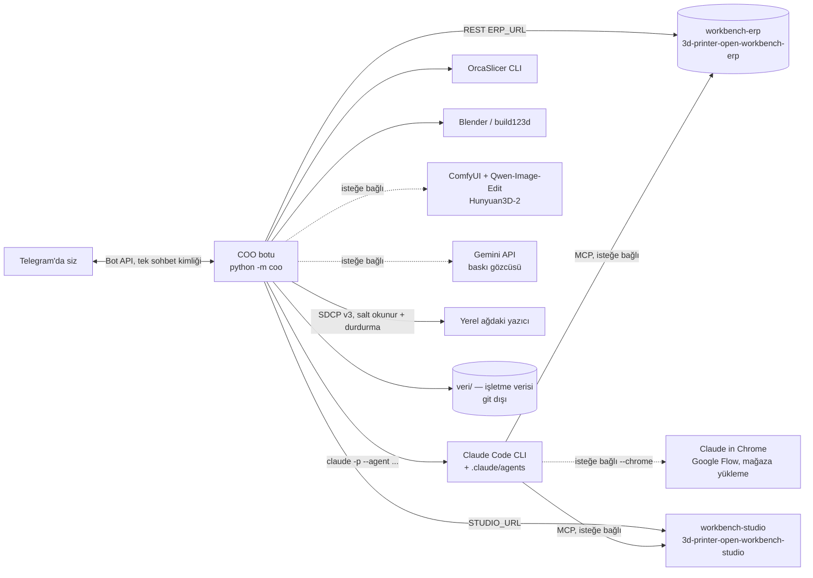

# 3D Printer Open Workbench — Bot

> 3D Printer Open Workbench ailesi: **Bot + ajanlar** · [ERP](https://github.com/3d-printer-open-workbench/3d-printer-open-workbench-erp) · [Studio](https://github.com/3d-printer-open-workbench/3d-printer-open-workbench-studio)

[English](README.md) · [Kurulum rehberi](docs/kurulum.md) · [Install guide](docs/install.md) · [Güvenlik](docs/guvenlik.md) · Lisans: MIT

Küçük bir 3B baskı işletmesi için Telegram'dan yönetilen asistan. Tek bir Telegram botuyla ("COO") konuşursunuz;
arkasında bir [Claude Code](https://docs.claude.com/en/docs/claude-code) ajan ekibi trend araştırır, fikri
basılabilir bir ürüne dönüştürür, OrcaSlicer ile dilimler, mağaza ve sosyal medya içeriğini hazırlar ve isteğe bağlı
ERP'de muhasebeyi tutar. Para harcayan, bir şey yayınlayan veya yazıcıya dokunan her adım **sizin onayınızı** bekler.

## Ne yapar

| Alan | Ne olur | Kim yapar |
|---|---|---|
| Trend ve fikir | Canlı pazar araştırması (Etsy, pazaryerleri, Pinterest, Printables/MakerWorld), kaynak URL ve tarihli; seçim yaptığınız görsel katalog | `trend-researcher` (Sonnet) |
| Ürün hattı | Konsept → 3B model (CAD / Studio üreteçleri / isteğe bağlı YZ 3B) → geometri kalite kapısı → kullanım testi → renk → dilimleme (3MF) | `cad-artist`, `mesh-validator`, `slicer-engineer` |
| Kullanım testi | Ürün vaadini tutuyor mu? Gerçek ölçülü referans nesneler (kulaklık, oyun kolu, telefon) fizik motorunda (MuJoCo + CoACD + python-fcl) modele bırakılır, masa eğilir, sarsılır; boşluklar ve devrilme açısı ölçülür. KALDI ise CAD ajanına ölçülü revize notu gider (en fazla 3 otomatik tur) | `kullanim-test-muhendisi`, `cad-artist` |
| Fiyat ve stok | ERP üzerinden BOM, maliyet, fiyat önerisi, alım kaydı, teklif (PDF) | `finance-tracker`, `support-responder` |
| Mağaza | Kıdemli editör review'undan (`coo.metin_denetim`) geçen kısa, insan sesli mağaza metni, galeri sırası, yükleme listesi; onayınızdan sonra Claude in Chrome ile yükleme | `cmo-store-director`, `seo-copywriter` |
| Sosyal medya | Ölçü/malzeme bandı gerçek veriden basılan poster (isteğe bağlı kendi Canva şablonunuzdan), Pinterest Pin'i, Reels/TikTok senaryosu, gerçek ürün dosyalarından HyperFrames (HTML → MP4) Reels, biten Reels'in YZ denetimi, Google Takvim'e eşitlenen Reels takvimi | `pinterest-curator`, `reels-tiktok-strategist`, `visual-storyteller` |
| Yazıcı | Salt okunur durum, kamera, dosya yükleme, isteğe bağlı YZ baskı hatası uyarısı, iki aşamalı acil durdurma | bot (`coo/yazici.py`, `coo/baski_goz.py`) |
| Denetim | CEO/CTO/CMO ajanları (Opus), Sonnet çıktısını size ulaşmadan önce denetler | `ceo-orchestrator`, `cto-architect`, `cmo-store-director` |
| Günlük iş | `/bekleyen`: kararınızı bekleyen her iş tek listede (onayla / not ile güncelle / yeniden üret); konsept, Reels, renk, pin ve mağaza paketinde "✏️ Not ile Güncelle"; ürün silme ve klasör temizliği (`/temizlik`, iki aşamalı, çöp kutusuna; satıştaki ürün silinemez) | bot (`coo/bekleyen_isler.py`, `coo/klasor_temizlik.py`) |
| Güvenlik | PreToolUse güvenlik kapısı (gizli değer, sızdırma, baskı başlatma, yıkıcı komut), ajan başına en az yetki tablosu, gizli ortam değişkenleri ajana geçmez, dış içerik karantinası, yerel red-team testi (`/guvenlik_testi`) | `.claude/hooks/`, `coo/karantina.py`, `coo/guvenlik_testi.py` |

22 ajan [`.claude/agents/`](.claude/agents) altındadır; ajan başına model `coo/__main__.py → AJAN_MODELLERI` içindedir.

## Mimari



Depo düzeni:

```
coo/                 bot paketi (python -m coo) ve testleri (coo/tests)
.claude/agents/      ajan tanımları (Markdown + ön bilgi)
.claude/commands/    etkileşimli Claude Code için eğik çizgi komutları (/ceo, /cto, /cmo, /ikas-yukle)
.claude/skills/      ajanlara önceden yüklenen beceriler (flow, ikas, canva, video-izle)
.claude/hooks/       güvenlik kapısı (PreToolUse) ve günlük güvenlik özeti
config/              Orca kategori/profilleri, sosyal medya ve Flow rehberleri, renk paleti, bakım planı,
                     konsept kütüphanesi (nötr örnek), marka rehberi (nötr örnek),
                     güvenlik tabloları (config/guvenlik), kullanım testi nesne/şablonları (config/kullanim_testi)
systemd/             kullanıcı servisi ve güvenlik özeti zamanlayıcı şablonları
docs/                kurulum, yerel YZ ve güvenlik rehberleri (TR/EN)
veri/                işletme verisi — install.sh oluşturur, depoya girmez
CLAUDE.md            her ajanın okuduğu kurallar — kendi işletmeniz için yeniden yazın
```

## Gereksinimler

- systemd'li Linux (Ubuntu 24.04+ ile denendi), Python **3.11+**
- Giriş yapılmış [Claude Code CLI](https://docs.claude.com/en/docs/claude-code) (Claude aboneliği veya API anahtarı)
- Telegram hesabı ve **@BotFather**'dan bot belirteci
- Önerilen: OrcaSlicer (dilimleme CLI'si), Blender 4+/5 (önizleme, renk render'ı), FFmpeg (video kurgusu)
- İsteğe bağlı: ComfyUI/Qwen-Image-Edit ve Hunyuan3D-2 için 12 GB+ VRAM'li NVIDIA GPU; Claude in Chrome eklentili
  Google Chrome (Google Flow, mağaza yükleme); Gemini API anahtarı (baskı gözcüsü, ücretsiz katman yeterli)
- `ortamlar/` (`WORKBENCH_ENVS`) altında isteğe bağlı ek ortamlar: `requirements-usage-test.txt` ile `.venv-cad`
  (MuJoCo, CoACD, python-fcl — kullanım testi), `yt-dlp`, `faster-whisper`, `av` ile `.venv-video`
  (`python -m coo.video_izle`: videoyu zaman damgalı kare panolarına + transkripte çevirir); `Video_Atölyesi/`
  (`WORKBENCH_VIDEO_WORKSHOP`) içinde HyperFrames Reels için Node.js
- İsteğe bağlı kardeş depolar: **3d-printer-open-workbench-erp** (maliyet, BOM, stok, teklif) ve
  **3d-printer-open-workbench-studio** (parametrik üreteçler, `print_check`)

## Hızlı başlangıç

- **Yerel YZ (isteğe bağlı):** ComfyUI + Qwen-Image-Edit, Hunyuan3D-2 ve Blender — bkz. [docs/yerel-yz.md](docs/yerel-yz.md).

```bash
git clone <bu-depo> 3d-printer-open-workbench-bot && cd 3d-printer-open-workbench-bot
./install.sh                 # venv, bağımlılıklar, .env, systemd kullanıcı birimi (tekrar çalıştırılabilir)
nano .env                    # TELEGRAM_BOT_TOKEN, TELEGRAM_CHAT_ID, WORKBENCH_SHOP_NAME ...
claude                       # bir kez, giriş için; sonra /exit
.venv/bin/python -m pytest -q
systemctl --user enable --now workbench-bot.service
./saglik.sh                  # sağlık kontrolü
```

Botunuza `/start` gönderin. Temiz Ubuntu'dan adım adım: [docs/kurulum.md](docs/kurulum.md).

## Yapılandırma

Tüm ayarlar `.env` dosyasından okunan ortam değişkenleridir ([`.env.example`](.env.example)):

| Değişken | Anlamı |
|---|---|
| `TELEGRAM_BOT_TOKEN`, `TELEGRAM_CHAT_ID` | zorunlu; bot yalnız bu sohbete yanıt verir, kimlik yoksa başlamaz |
| `WORKBENCH_SHOP_NAME`, `WORKBENCH_SHOP_URL`, `WORKBENCH_PINTEREST_URL` | poster, PDF teklif ve paylaşım metinlerindeki mağaza kimliği |
| `PRINTER_IP` | yerel ağdaki SDCP v3 yazıcı (ör. Elegoo Centauri Carbon); salt okunur + iki aşamalı durdurma |
| `ERP_URL`, `STUDIO_URL` | isteğe bağlı kardeş servisler |
| `GEMINI_API_KEY` | isteğe bağlı; YZ baskı gözcüsü ve baskı sonu raporu |
| `WORKBENCH_CLAUDE_CHROME` | `0` ise ajanlara `--chrome` verilmez |
| `WORKBENCH_CLAUDE_PERMISSION_MODE` | başsız ajanların izin kipi (varsayılan `bypassPermissions`) |
| `WORKBENCH_DATA`, `WORKBENCH_CONFIG`, `WORKBENCH_ENVS`, `WORKBENCH_AI_TOOLS` | yol değiştirme |
| `WORKBENCH_SANDBOX` | `0` ise ajanlara OS sandbox ayarı hiç verilmez (bkz. [docs/guvenlik.md](docs/guvenlik.md)) |
| `WORKBENCH_VIDEO_WORKSHOP` | HyperFrames proje klasörü (varsayılan `<kök>/Video_Atölyesi`) |

Kendi işletmenize göre düzenleyeceğiniz içerik: `CLAUDE.md`, `config/marka/marka-rehberi.md`,
`config/konseptler/*.md`, `config/renk_paleti.yaml`, `config/orca/kategoriler.yaml`, `config/bakim.yaml`.

### ERP ve Studio ile konuşma (ikisi de isteğe bağlı)

- **REST:** bot stok, kuyruk, fiyat ve baskı muhasebesi için ERP'yi `ERP_URL` (vars. `http://127.0.0.1:8000`)
  üzerinden çağırır; Studio sayfalarını `STUDIO_URL` (vars. `http://127.0.0.1:7870`) ile açar.
- **MCP:** ajanlar ERP ve Studio araçlarını **`workbench-erp`** ve **`workbench-studio`** adlı Claude Code MCP
  sunucularıyla kullanır. [`.mcp.json.example`](.mcp.json.example) dosyasını `.mcp.json` olarak kopyalayıp yolları
  düzeltin; araç izinleri `.claude/settings.json` içinde hazırdır.
- Bunlar olmadan da bot çalışır; ERP/Studio düğmeleri servise ulaşılamadığını bildirir.

### Dilimleme profilleri

`config/orca/` yalnız `kategoriler.yaml` kategori tablosuyla gelir. Makine, filament ve proses profilleri
OrcaSlicer'ın üretici ön ayarlarından (AGPL-3.0) türediği için depoda **yoktur**. OrcaSlicer'ın
`resources/profiles/<Üretici>` ve `OrcaFilamentLibrary` klasörlerini `config/orca/kaynak/` altına (git dışı)
kopyalayın; bot ilk dilimlemede düzleştirilmiş profilleri `config/orca/` altına kendisi üretir. Varsayılanlar
Elegoo Centauri Carbon 0.4 mm nozul içindir; başka yazıcı için `coo/orca_dilim.py` içindeki
`TABAN_PROSES`/`MAKINE` değerlerini uyarlayın.

## Güvenlik kuralları (yerleşik)

- **Bot asla baskı başlatmaz.** Yalnız durum/kamera okur, dosya yükler ve sizin iki aşamalı onayınızla *durdurma*
  gönderebilir. YZ baskı gözcüsü yalnız uyarır.
- **Onaylar sizindir:** konsept seçimi, içerik, fiyat, mağazaya yükleme, dilimleme önerisinin uygulanması, alım ve
  teklifler. Ajanlar hazırlar; siz Telegram'dan onaylarsınız.
- **Uydurma veri yok:** fiyat, yorum, satış verisi açılmış kaynak URL'si ve tarihle gelir; görsellerdeki ölçü ve
  malzeme gerçek veriden deterministik basılır, YZ'ye çizdirilmez.
- **Gizli değerler `.env`'dedir** (git dışı, `chmod 600`). Depoya veya sohbete gizli değer yazılmaz.
- **Güvenlik kapısı.** PreToolUse hook'u (`.claude/hooks/guvenlik_kapisi.py`) bu klasördeki her Claude oturumunda
  gizli dosya erişimini, izinsiz adrese veri gönderimini, baskı başlatma ve yıkıcı komutları engeller; bot ajanları
  `config/guvenlik/ajan_yetkileri.json` ile en az yetki alır (Chrome yalnız listelenen ajan ve sitelere), gizli
  ortam değişkenleri ajan başlamadan süzülür. Ayrıntı, tehdit modeli ve sınırlar: [docs/guvenlik.md](docs/guvenlik.md).
- **Tek sohbete kilitli.** Ajanlar araç erişimiyle başsız çalışır (varsayılan `bypassPermissions`); bu yüzden botu
  yalnız sizin sohbet kimliğiniz yönetebilir. Botu root olarak değil, kendi masaüstü kullanıcınızla çalıştırın;
  ayrı bir kullanıcı hesabı, daha sıkı `WORKBENCH_CLAUDE_PERMISSION_MODE` ve `.claude/settings.json` yasak kurallarını
  değerlendirin.

## Üçüncü taraf yazılım ve modeller (depoda yok)

Bu depo yalnız bot kodu, ajan istemleri ve örnek yapılandırmayı içerir. Diğer her şeyi kendiniz indirir ve
lisansını kendiniz kabul edersiniz:

- **ComfyUI** — GPL-3.0. Ayrı kurulur; bot onunla harici süreç olarak konuşur.
- **Qwen-Image-Edit** ağırlıkları (metin kodlayıcı / VAE dahil) — yazım tarihinde Apache-2.0; indirmeden önce
  Hugging Face model kartını kontrol edin.
- **Hunyuan3D-2** (Tencent) — *Tencent Hunyuan 3D Community License*. Bölge maddesi **Avrupa Birliği, Birleşik
  Krallık ve Güney Kore'yi kapsam dışı bırakır**; kullanım/ölçek sınırları vardır. İndirmeden önce kullanma hakkınız
  olup olmadığını kontrol edin; hat onsuz da çalışır (CAD/Studio rotaları).
- **OrcaSlicer** — AGPL-3.0. `config/orca/` içindeki düzleştirilmiş profil JSON'ları OrcaSlicer'ın üretici
  profillerinden türetilmiştir; üretici kaynak dosyaları dağıtılmaz.
- **Blender** (GPL), **FFmpeg** (LGPL/GPL), **Claude Code** (Anthropic koşulları), **Google Gemini / Flow** (Google
  koşulları), **Telegram Bot API** (Telegram koşulları).
- `requirements.txt` içindeki Python paketleri kendi lisanslarıyla.

## Sorumluluk reddi

Bu bağımsız bir açık kaynak projesidir; Anthropic, Telegram, Google, Elegoo, OrcaSlicer, Tencent, Alibaba/Qwen veya
herhangi bir mağaza platformuyla bağlantılı değildir, onlarca onaylanmamıştır. Gerçek bir işletmenin bazı işlerini
otomatikleştirir ancak **hiçbir garanti olmadan** sunulur ([LICENSE](LICENSE)). Yazıcı güvenliği, model ve içerik
lisansları, pazaryeri kuralları, ülkenizdeki vergi ve tüketici mevzuatı ile onayladığınız her işlem sizin
sorumluluğunuzdadır. YZ ajanları hata yapar: çıktılarını müşteriye ulaşmadan önce gözden geçirin.
